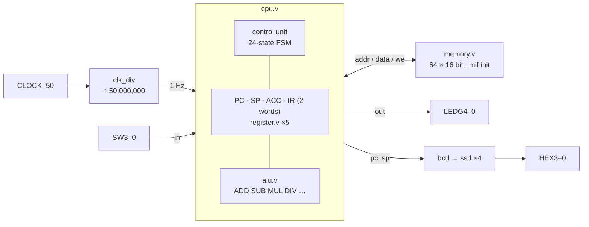

# verilog-cpu: a 16-bit CPU on a DE0 FPGA board

[](https://github.com/djokerg/verilog-cpu/actions/workflows/ci.yml)

A small 16-bit processor written in Verilog and run on a Terasic DE0 board (Altera Cyclone III).
It has a 24-state control unit, an 8-function ALU and 64 words of RAM preloaded with a program.
Input comes from the slide switches and output goes to the green LEDs. The program counter and stack pointer
are shown in decimal on the 7-segment displays, with the clock slowed to 1 Hz so you can watch every step.

<!-- VIDEO: drag the board video into this README in GitHub's web editor and put the generated
     https://github.com/user-attachments/... link on its own line here. -->

**[▶ Try it in your browser](https://djokerg.github.io/verilog-cpu/).** This is a virtual DE0 running this exact
Verilog, compiled to WebAssembly. Flip the switches, reset with SW9 and step the clock.

```
┌──────────────────── Terasic DE0 · Cyclone III ─────────────────────┐
│                                                                    │
│     SP           PC                                                │
│    _    _        _                                                 │
│   |_    _|       _|    |                                           │
│   |_|   _|      |_     |                                           │
│   HEX3 HEX2     HEX1 HEX0                                          │
│                                                                    │
│   LEDG  ○ ○ ○ ○ ○ ● ○ ● ○ ●    OUT = 21 (10101)                    │
│   SW    ▀ ▄ ▄ ▄ ▄ ▄ ▄ ▄ ▀ ▀    SW9 = run, SW3-0 = 3                │
│         9 8 7 6 5 4 3 2 1 0                                        │
│                                                                    │
└────────────────────────────────────────────────────────────────────┘
  CPU clock  54   state halt
  IR f000  STOP
  A=8  B=8  C=3  D=9  E=21  F=0  G=0
  LED history: 8 → 16 → 7 → 21
```
*`./run.sh` at the end of the demo program. The digits are drawn from the real segment outputs of the design.*

## Quick start

You only need **Docker**.

```bash
git clone https://github.com/djokerg/verilog-cpu.git && cd verilog-cpu

./run.sh                         # animated board running tooling/mem_init.mif (switch inputs 8, 9, 3)
./run.sh --in 1,2,3              # same program, your own switch values (0-15)
./run.sh --delay 1               # real board speed: 1 CPU clock per second
./run.sh test-prog               # the second program, tooling/mem_init_test.mif
./run.sh my_program.mif --in 6   # any program in Quartus .mif format
./run.sh --log                   # instruction trace instead of the animation
./run.sh test                    # test suite
./run.sh web                     # build the browser board and serve it on http://localhost:8000
```

`./run.sh --log` shows the program's instruction trace and what the board displayed:

```
   8: 7101  IN A   <- switches SW3-0 = 8
   9: 8101  OUT A
        LEDs =  8  (01000)
  10: 0210  MOV B, A
  11: 1312  ADD C, A, B
  12: 8301  OUT C
        LEDs = 16  (10000)
  13: 7401  IN D   <- switches SW3-0 = 9
  14: 2334  SUB C, C, D
  15: 0530  MOV E, C
  16: 8501  OUT E
        LEDs =  7  (00111)
  17: 7301  IN C   <- switches SW3-0 = 3
  18: 3553  MUL E, E, C
  19: 8501  OUT E
        LEDs = 21  (10101)
  20: f000  STOP
  HALT after 54 CPU clocks; display SP=63 PC=21
```

At the board's 1 Hz clock, that program takes 54 seconds.

## On the board

| Board | Signal | Use |
|---|---|---|
| `CLOCK_50` | `clk` → [`clk_div`](src/synthesis/modules/clk_div.v) | 50 MHz divided by 50,000,000 → 1 Hz CPU clock |
| `SW9` | `rst_n` | reset: flip down and up (the CPU resets on the falling edge) |
| `SW3`–`SW0` | `in` | the value an `IN` instruction reads (0–15) |
| `LEDG4`–`LEDG0` | `out` | the value written by `OUT` / `STOP` (low 5 bits) |
| `HEX3` `HEX2` | `sp` | stack pointer, decimal ([`bcd`](src/synthesis/modules/bcd.v) → [`ssd`](src/synthesis/modules/ssd.v)) |
| `HEX1` `HEX0` | `pc` | program counter, decimal |

## Architecture



[`top.v`](src/synthesis/modules/top.v) connects the parts, and [`DE0_TOP.v`](src/synthesis/DE0_TOP.v) maps them onto the board's pins.

## Instruction set

Every instruction is one 16-bit word, plus a second word for `MOV` with a constant. The program starts at address 8.

```
 15    12 11     8 7      4 3      0
┌────────┬────────┬────────┬────────┐
│ opcode │  op 1  │  op 2  │  op 3  │     operand = I a a a
└────────┴────────┴────────┴────────┘       I = 1: indirect   aaa = address 1..7 (A..G)
```

Memory words 1–7 act as the registers **A–G**. A direct operand `A` means `mem[1]`, and an indirect operand `[A]`
means `mem[mem[1]]`, so indirect operands can reach all 64 words.

| Opcode | Instruction | Effect |
|---|---|---|
| `0` | `MOV x, y` (op 3 = `0000`) | x ← y |
| `0` | `MOV x, #k` (op 3 = `1000`) | x ← k, the constant in the next word |
| `1` | `ADD x, y, z` | x ← y + z |
| `2` | `SUB x, y, z` | x ← y − z |
| `3` | `MUL x, y, z` | x ← y × z |
| `4` | `DIV x, y, z` | x ← y ÷ z |
| `7` | `IN x` | x ← SW3–0 |
| `8` | `OUT x` | LEDs ← x |
| `F` | `STOP x, y, z` | shows each non-empty operand on the LEDs, one per clock, then halts |
| other | | halt |

Example: `1312` is `ADD C, A, B`, and `0908 0007` is `MOV [A], 7` (store 7 at the address held in A).

## How it works

**One state per memory access.** [`memory.v`](src/synthesis/modules/memory.v) has a synchronous read (the data appears one clock after the address), and the CPU
has no register file, since its operands live in memory. Every operand fetch therefore gets its own FSM state, and indirect
operands get one more. That's why [`cpu.v`](src/synthesis/modules/cpu.v) has 24 states, and `ADD C, [A], B` takes more clocks than `ADD C, A, B`.

**Two-process FSM.** The sequential block only latches `state`, `out` and the registers. Everything else is one
combinational `always @(*)` that sets every control signal to a default first, so no latches are inferred.
The `load(addr)` / `store(addr, data)` tasks drive the memory bus.

**Instruction fetch.** `fetch1` puts PC on the bus and increments it. `fetch2` latches the word into IR and already checks
whether it's a `MOV` with a constant (`0xx8`). If it is, `fetch3` reads the second word into the low half of IR.

**ALU reuse.** The arithmetic opcodes 1–4 map directly onto ALU functions (`alu_oc = opcode − 1`). The second operand
waits in ACC while the third is read, and the ALU result goes back to memory, directly or through a pointer.

**Universal register.** [`register.v`](src/synthesis/modules/register.v) supports clear, load, increment, decrement and shifts. PC (increment), SP (load),
ACC and the two IR halves are all instances of it.

**Display.** [`bcd.v`](src/synthesis/modules/bcd.v) splits PC and SP into tens and ones, and [`ssd.v`](src/synthesis/modules/ssd.v) turns each digit into active-low segments.

## Simulation, tests and the browser board

The course tools (Questa and Quartus) are proprietary, so this repo adds an open-source path. **None of the design files are
modified for it.**

- [`sim/board_tb.v`](sim/board_tb.v) instantiates the unmodified `top` with a faster clock divider (`DIVISOR=2`) and loads the
  `.mif` program into memory. It toggles SW9 for reset and sets SW3–0 while an `IN` is being decoded, like a person at the board.
- [`sim/board.py`](sim/board.py) converts `.mif` files, runs Icarus Verilog, decodes the 7-segment outputs and draws the board.
  It includes a disassembler for the instruction set.
- [`scripts/run-tests.sh`](scripts/run-tests.sh) checks both programs' LED sequences and final display: `8 16 7 21` (the values
  in `mem_init.mif`'s own comments) and `5 9 7 2 9`. It also runs the original ALU testbench and lints the design with Verilator.
- [`web/`](web/) is the browser board. Verilator turns the same RTL into C++, Emscripten compiles that to WebAssembly,
  and [`web/index.html`](web/index.html) drives the switches and clock and draws what the model outputs.
  CI builds it on every push and deploys it to GitHub Pages.

## Running on a real DE0

This needs Windows with **Quartus II 13.1** (the last version with Cyclone III support) and Questa/ModelSim for the course
simulation flow. The course [`makefile`](tooling/makefile) wraps both:

```
cd tooling
./xpack/bin/make synth_all     # analysis & synthesis, fitting, assembly, timing
./xpack/bin/make synth_pgm     # program the board over USB-Blaster (JTAG)
./xpack/bin/make simul_all     # Questa simulation of src/simulation (ALU / register testbenches)
```

Set the tool paths at the top of the makefile first. The program loaded on the board is the `FILE_NAME` parameter in
[`DE0_TOP.v`](src/synthesis/DE0_TOP.v) (`mem_init_test.mif`). [`DE0_CV_TOP.v`](src/synthesis/DE0_CV_TOP.v) targets the newer DE0-CV (Cyclone V).

## Project layout

```
src/synthesis/modules/   cpu, alu, register, memory, clk_div, bcd, ssd (+ deb, red)
src/synthesis/           board wrappers: DE0_TOP.v (Cyclone III), DE0_CV_TOP.v (Cyclone V)
src/simulation/          ALU + register testbench (top.v) and UVM testbench for the register (top.sv)
tooling/                 course makefile + configs, mem_init.mif / mem_init_test.mif programs
sim/ scripts/ web/       open-source simulation, tests and the browser board
Dockerfile, run.sh       one-command toolchain
```

## Limitations and known issues

- No jumps or branches, so programs run straight through to `STOP`. SP is initialised to 63 but no instruction uses it.
- Input is 4 bits (SW3–0) and output shows the low 5 bits on the LEDs. Memory is 64 words.
- The ALU also implements NOT, XOR, OR and AND, but the decoder only reaches ADD/SUB/MUL/DIV.
- `STOP`'s second operand tests bit 4 (its lowest address bit) instead of bit 7 for indirect addressing. A second
  operand of A, C, E or G is read through a pointer, and `[B]`, `[D]` or `[F]` is read directly.
- `DE0_CV_TOP.v` doesn't connect `rst_n`, so that wrapper needs a reset switch added before it runs on a DE0-CV.
- The comments in `mem_init_test.mif` say `MUL` and `7, 2, 14`. The instruction `1392` is `ADD`, and the CPU correctly shows `7, 2, 9`.

## Credits

Designed by Đorđe Grebović for the VLSI design course at the **School of Electrical Engineering (ETF), University of Belgrade**, 2023/24.

Provided by the course: the build tooling in `tooling/` (makefile, configs, board assignment files, the xPack Windows tools),
the board wrappers `DE0_TOP.v` / `DE0_CV_TOP.v`, and the `deb`, `red` and `ssd` modules from the labs.
